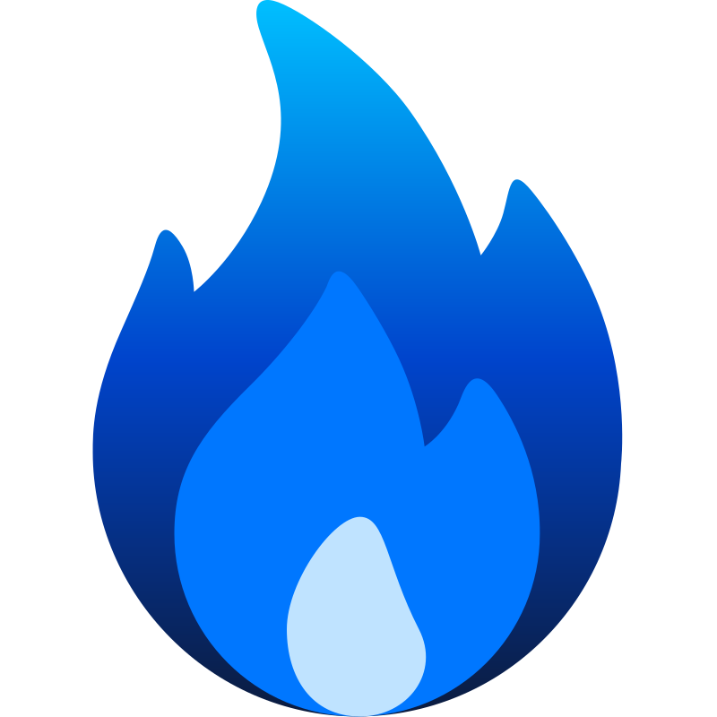
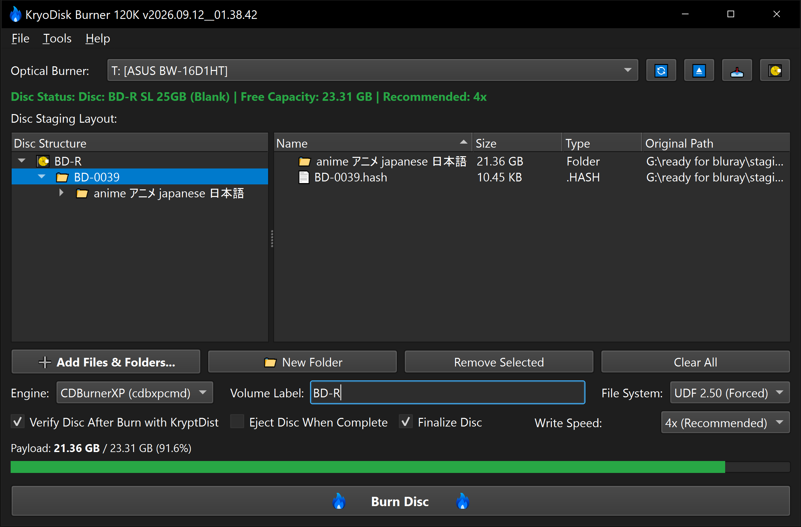

#  KryoDisk Burner 120K™ 
**A high-performance optical disc authoring and burning utility supporting CD, DVD, Blu-ray, and BDXL media formatted in UDF 2.50 / UDF 2.60.**

---

## Overview & User Manual
**KryoDisk Burner 120K™** is a specialized optical disc authoring and burning application engineered for Windows. Built for archivists, system administrators, and digital preservationists, it pairs direct hardware-level device communication with pure **Universal Disk Format (UDF 2.50 / UDF 2.60)** file system mastering. 

By utilizing **ImgBurn / ImgBurnPortable** as its primary authoring engine (with legacy fallback to **CDBurnerXP CLI**), KryoDisk completely eliminates legacy ISO9660 file size caps (2GB/4GB) and directory depth restrictions. All burns are authored with guaranteed single-session disc finalization and paired with automated post-burn cryptographic integrity verification via **KryptDist**.

---

## 1. Quick Start: Burning Your First Disc

Follow these steps to stage and burn an archival disc:

1. **Insert Blank Media & Choose Drive:**
   * Insert a blank write-once optical disc (BD-R, DVD-R, DVD+R, or CD-R) into your burner.
   * Select your hardware drive from the **Optical Burner** dropdown. The status banner will display the detected media type, physical specification, and usable free capacity in green.
2. **Stage Files and Folders:**
   * Click **➕ Add Files & Folders...** to open the dual-pane file picker, hold `Ctrl` or `Shift` to select items, and click **Add Selected**.
   * Alternatively, drag and drop files directly into the window or send them to KryoDisk via the Windows **SendTo** context menu.
3. **Set the Volume Label:**
   * Enter a descriptive disc title in the **Volume Label** field (up to 32 characters conforming to UDF standards, e.g., `COLD_STORAGE_2026`).
4. **Inspect the Capacity Meter & Path Indicator:**
   * Confirm the green **Payload** bar shows sufficient free space and does not indicate *OVER CAPACITY*.
   * Verify that the **Max Path Length** indicator displays `[OK]`. If it turns red, see *Section 3: In-Disc Path Length Validation & UDF Rules* below.
5. **Start Burning:**
   * Click **Burn Disc**. The interface automatically switches to the live execution view, presenting live percentage progress, elapsed duration, remaining countdown, and continuous engine telemetry logs.

---

## 2. Staging & Organizing Your Disc Layout

KryoDisk features an interactive dual-pane disc layout manager that allows you to organize the destination disc hierarchy completely independently of your host computer's folder structure.

* **Left Hierarchy Tree:** Represents the folder structure that will exist on the burned disc. Selecting any folder updates the right pane to show its immediate contents.
* **Right Contents Table:** Lists the files and subfolders contained within the currently highlighted directory, displaying individual file sizes, file types, and the original local path on your machine.
* **Creating Virtual Folders:** Select a destination folder in the left tree and click **📁 New Folder** to create an empty virtual directory on the disc.
* **Non-Destructive Removal:** Select any staged file or folder and click **Remove Selected** (or press the `Delete` key). Removing staged items **never** alters, moves, or deletes the original files on your storage drive.
* **Resetting the Project:** Click **Clear All** to unstage all files and reset to an empty layout.

---

## 3. In-Disc Path Length Validation & UDF Rules

Many burning utilities fail silently halfway through a write session due to Windows path limitations. KryoDisk eliminates write failures by continuously inspecting every staged path against exact filesystem specifications.

### In-Disc Evaluation (ImgBurn Engine)
KryoDisk calculates path lengths based on where files will reside **physically on the optical disc** starting from the root (`\`). Deep directory paths on your source computer (such as `C:\Users\Username\Documents\...`) do not penalize your available path budget on the disc.

### OSTA UDF Path Limits
* **UDF Unicode (16-bit):** When file or directory names contain international characters (such as Japanese Kanji, Kana, CJK characters, Cyrillic, accented letters, or symbols), UDF specifications enforce:
  * Maximum **127 characters** per individual file or directory name.
  * Maximum **511 characters** for the cumulative directory path.
* **UDF ASCII / Latin-1 (8-bit):** For paths composed strictly of standard Western alphanumeric characters, UDF permits:
  * Up to **254 characters** per individual file or directory name.
  * Maximum **1023 characters** for the cumulative directory path.

### Warning Indicator & Resolution
If any staged file, directory, or nested subfolder exceeds these limits:
1. The status indicator immediately displays a red warning: `⚠ [Item(s) Exceed Limit!]`.
2. The offending rows in the contents table and left tree turn red with detailed tooltip explanations.
3. Clicking **Burn Disc** displays a comprehensive dialog listing the longest offending paths so you can shorten directory or file names before committing data to permanent media.

---

## 4. Post-Burn Verification (KryptDist Integration)

When **Verify Disc After Burn with KryptDist** is enabled, KryoDisk performs comprehensive, bit-for-bit cryptographic data validation before releasing the disc.

### Primary Checksum Container Placement
KryptDist searches for a master checksum manifest (`.hash`, `.b3`, `.blake3`, `.sha256`, `.sha512`, `.xxh3`, `.md5`, etc.) located at:
* The **Disc Root** (depth 0, e.g., `\ARCHIVE_2026.hash`), or
* An **Immediate Top-Level Folder** (depth 1, e.g., `\BACKUP_SET\BACKUP_SET.hash`).

*Note: Restricting detection to depth 0 and 1 ensures KryoDisk targets your master archive container rather than accidental nested test hashes.*

### The Verification Workflow
1. **Pre-Burn Checksum Guard:** If verification is checked but no primary checksum container is detected in the staged files, KryoDisk displays a warning prompt. You can choose to cancel and add the container, or disable verification and proceed with burning only.
2. **Thermal Diode Cooldown & Cache Flush:** Burning optical media requires continuous high-power laser output. Upon write completion, KryoDisk initiates a settling pause (default: 25 seconds; configurable under **Preferences > Options**) allowing the optical pickup unit and laser diode to stabilize before switching to high-speed read mode. It then issues a volume dismount (`FSCTL_DISMOUNT_VOLUME`) to force Windows to purge its RAM sector cache, ensuring data is read physically from the media.
3. **15-Second Mount Probe:** An asynchronous background check verifies that the disc filesystem and volume descriptors mount successfully within 15 seconds. If a severe write error prevented filesystem mounting, the operation halts cleanly without freezing the interface.
4. **20-Second Stall Watchdog:** Verification runs headlessly via `KryptDist.py` with real-time throughput monitoring. If the optical drive stalls or encounters unreadable sectors, the 20-second inactivity watchdog terminates the hung process and reports the exact failing sector.
5. **Safe Ejection:** When verification is requested, disc tray ejection is deferred until verification finishes with 100% integrity.

---

## 5. Hardware Safeguards & Auto-Recovery

KryoDisk incorporates specialized drive safeguards configured under **Tools > Preferences > Options**:

* **Pre-Burn Volume Cache Flush:** Issues a software volume dismount (`FSCTL_DISMOUNT_VOLUME`) before starting any burn. This releases stale Windows volume locks and handles left by background indexers, eliminating *Device Busy* and `0x80070005` errors.
* **Write Stall Auto-Retry Watchdog:** Some external USB and SATA burners occasionally stall during lead-in laser calibration (0%). If a drive sits at 0% without writing track data past the timeout threshold (default: 40 seconds), KryoDisk terminates the hung process, flushes device handles, and automatically re-attempts the burn.
* **Motorized Tray Reset:** On the final retry attempt, if the burner features a motorized tray, KryoDisk executes an automated tray eject and reload cycle. This forces drive firmware to re-seat the disc, recalibrate optical focus, and re-read track geometry before writing.

---

## 6. Media Support & Rewritable Policy

### Archival Write-Once Media (Default Mode)
For permanent cold storage, write-once media cannot be overwritten or altered:
* **Supported Formats:** CD-R, DVD-R, DVD+R, DVD±R DL (8.5GB), BD-R (25GB), BD-R DL (50GB), BD-R TL (100GB BDXL), and BD-R QL (128GB BDXL).
* **Guaranteed Finalization:** All sessions are finalized and closed on completion to ensure long-term readability across standard optical drives and operating systems.

### Rewritable Media Policy (`-DevDebug` Only)
To prevent accidental reliance on volatile, phase-change rewritable media for long-term cold archives, rewritable discs (BD-RE, CD-RW, DVD±RW, DVD-RAM) are restricted to development mode:
* Launch with the `-DevDebug` flag to unlock rewritable media burning.
* In DevDebug mode, the capacity bar evaluates staged files against the disc's **total physical erased size** rather than leftover space from previous sessions.
* The burn button automatically becomes **Erase & Burn Disc**, automatically overwriting existing data without requiring separate manual erase passes.
* The **Quick Erase (🧹)** tool is unlocked on the main toolbar to blank test discs on demand.

---

## 7. Audio Notifications & Appearance

* **Natural Spoken Announcements:** Powered by Kokoro TTS, KryoDisk features spoken alerts for session events (*Burn Completed*, *Burn Completed & Verified*, *Burn Initialization Failed*, *Burn Failed*, and *Verify Failed*).
* **Voice Models:** Choose between **River (USA female)** and **Lily (Great Britain female)** under **Tools > Preferences > Notifications**.
* **Audio Testing:** Click the preview button (**▶**) in Preferences to test playback.
* **Mute Toggle:** Check *Disable Notification Sounds* to silence all spoken alerts and sound effects.
* **Themes:** Select between **Dark**, **Light**, or **System** themes under **Tools > Themes**.

---

## 8. Troubleshooting & FAQ

### Q: The Optical Burner dropdown says "No Optical Drives Detected".
* **Solution:** Confirm your drive's power and data cables are securely connected and click the refresh button (**🔄**). Because optical hardware access requires direct device handles, ensure KryoDisk was launched with Administrator privileges.

### Q: Status reports "Disc Finalized / Read-Only (Free: 0 B)".
* **Solution:** The inserted disc has already been closed and finalized. Write-once media (BD-R, DVD-R) cannot be modified or appended once finalized. Press **⏏** to eject the disc and insert blank media.

### Q: The burn button says "Path Length Limit Exceeded" and cannot be clicked.
* **Solution:** One or more staged files or folders exceed UDF standard limits. Inspect the rows highlighted in red in the contents table, right-click or rename the offending files or folders, and shorten them until the status indicator turns green (`[OK]`).

### Q: Verification fails with "Disc check failed (15s limit)".
* **Solution:** The drive completed burning the track, but Windows was unable to mount or read the resulting filesystem table. This typically indicates a low-grade disc blank, an aging optical laser, or burning at excessive write speeds. Try burning at a lower multiplier (e.g., 4x for BD-R).

### Q: Can I inspect what is physically recorded on a burned disc?
* **Solution:** Click the physical disc browser icon (**💽**) on the main toolbar. This opens a read-only explorer dialog that traverses the live optical media directly from your drive.

---

## Feature Reference

| Option / Feature | Description |
| :--- | :--- |
| **Dual Burning Engines** | Primary authoring via ImgBurn (long paths) [Default] alongside legacy CDBurnerXP CLI backend. |
| **UDF 2.50 & 2.60 Mastering** | Builds compliant Universal Disk Format virtual file systems; ImgBurn mode authors strictly pure UDF (ISO9660 disabled). |
| **BDXL & Multi-Format Support** | Complete support for CD-R, DVD±R, Blu-ray, and multi-layer BDXL media up to 128GB Quad-Layer (QL). |
| **Dual-Pane Layout Browser** | Split hierarchical browser for organizing virtual disc directories and staged payloads. |
| **Live Path Length Validator** | Real-time in-disc path monitoring: ImgBurn UDF (127/511 Unicode, 254/1023 ASCII) vs CDBurnerXP (UDF names + Win32 260/248 limits). |
| **Unicode & Japanese Characters** | Full end-to-end UTF-8 pipeline supporting Japanese (Kanji, Hiragana, Katakana), CJK, Cyrillic, and international symbols. |
| **Dual-Explorer Add Dialog** | Simultaneous file and directory picker for quick batch staging. |
| **Physical Disc Explorer (💽)** | Integrated browser dialog to inspect files physically present on the inserted disc. |
| **Live Capacity Meter** | Real-time visual capacity bar displaying payload usage against media capacity with overload warnings. |
| **Guaranteed Session Finalization** | Finalizes disc sessions on completion to ensure long-term archival data integrity. |
| **Hardware Tray Controls** | Direct software-driven drive tray eject (⏏) and motorized tray close (📥) commands. |
| **Direct Hardware Discovery** | Queries physical drive via standard SCSI Pass-Through (`INQUIRY 0x12`) to detect true vendor/model past OS/USB bridge caches. |
| **Hardware Speed Descriptors** | Queries drive firmware for supported disc write multipliers with recommended presets. |
| **Pre-Burn Verify Estimation** | Models physical optical throughput, seek latencies, and remount overhead for accurate pre-burn ETAs. |
| **Persistent Session Countdown**| Establishes a 0% baseline session estimate that persists jitter-free across both burn and verify phases. |
| **Primary Checksum Guard** | Validates presence of a primary `.hash` at disc root or depth-1 folders before burning; prevents false matches on nested files. |
| **Pre-Burn Flush & I/O Recovery** | Issues `FSCTL_DISMOUNT_VOLUME` prior to burning to clear stale OS sector locks; auto-recovers from ImgBurn I/O error prompts. Toggleable in Options. |
| **Write Stall Watchdog & Recovery** | Detects 0% write stalls, dismounts volume, and auto-retries with motorized tray cycling; timeout and retries configurable in Options. |
| **Thermal Cooldown & Cache Flush** | Settling countdown (configurable duration, default 25s) and volume dismount (`FSCTL_DISMOUNT_VOLUME`) flush OS sector cache without physical tray cycling. |
| **Fast Disc Check Guard** | Asynchronous 15s background mount check catches bad burns and unreadable media without UI lockups. |
| **KryptDist Post-Burn Check** | Scans burned discs for primary manifest and verifies 100% bit-level data integrity, guarded by a 20s stall watchdog. |
| **Total Elapsed Time Reporting**| Logs a complete elapsed duration summary (total time, burn time, verify time) at the close of every session. |
| **Erase & Burn Disc (DevDebug)** | Evaluates rewritable media by total physical erased size; dynamic action button overwrites data seamlessly. |
| **Headless & Silent Burning** | Executes ImgBurn on an isolated hidden Win32 desktop with sub-frame 10ms prompt handling and off-screen positioning; zero popups or focus stealing. |
| **Preferences & Safeguards (3 Tabs)** | Configure engines (**Engines**), hardware safeguards (**Options**), and spoken voice events (**Notifications**) under **Tools > Preferences**. |
| **Voice Audio Notifications** | Spoken voice announcements powered by Kokoro TTS (River & Lily), interactive preview button (▶), event toggles, and mute styling. |
| **Quick Erase (🧹) [DevDebug]** | Rapidly blanks volume descriptors on rewritable media (BD-RE, DVD-RW, CD-RW) via CDBurnerXP CLI. |
| **Instant Launch Flag** | Run with `-DevDebug -NoDriveScan` to bypass startup drive queries for instant launch. |
| **Theme Engine** | Full support for Dark, Light, and System-synced palettes via custom `QPalette` implementation. |

---

## Command Line Flags & DevDebug Mode

| Flag | Description |
| :--- | :--- |
| `-DevDebug` | Activates verbose console logging, unlocks the Quick Erase (🧹) tool on the toolbar, and enables rewritable media workflows. |
| `-NoDriveScan` `-NoScan` `-SkipDriveScan` | When used in conjunction with `-DevDebug`, bypasses the 5-second optical hardware query and disc spin-up on startup. Click **🔄** to query hardware on demand. |

---

## Engine & Script Discovery

Burning backends and verification scripts are automatically discovered in the following order:
1. Custom configured paths set in **Tools > Preferences > Engines**.
2. User and System `PATH` environment variables (including new additions prior to reboot).
3. `KryoDisk-Burner-120K_internal\bin\` directories (`cdbxpcmd.exe`, `ImgBurnPortable\`, `KryptDist.py`).
4. `C:\tools\` and `C:\scripts\` tool installations (`C:\tools\CDBurnerXP\`, `C:\tools\ImgBurnPortable\`, `C:\scripts\KryptDist.py`).
5. Standard 32-bit and 64-bit `Program Files` installations.

---

## Dependencies & Requirements
* **Operating System:** Microsoft Windows 10, 11, or Windows Server (64-bit).
* **Elevation:** Administrator privileges required for exclusive optical burner hardware access.
* **Python Runtime:** Python 3.14.5 or higher recommended.
* **Python Packages:**
  * `PyQt6` &mdash; Graphical User Interface framework (`pip install PyQt6`).
  * `pywin32` &mdash; Windows IMAPI2 COM hardware queries (`pip install pywin32`).
* **Burning Engines:**
  * **[ImgBurn](https://www.imgburn.com/)** (`ImgBurn.exe` / `ImgBurnPortable`) [Default & Recommended].
  * **[CDBurnerXP CLI](https://sourceforge.net/projects/cdburnerxp/)** (`cdbxpcmd.exe`) [Legacy CLI].
* **Integrity Verifier:** **[KryptDist](https://git.disroot.org/pwshAgyjkcrg761/KryptDist-py.git)** (`KryptDist.py` or `KryptDist.exe`) for automated post-burn cryptographic checksum verification.

---

## Assets & Licensing
This software is released under the **GNU General Public License v3**.

### Icon Credits
* **File:** `kryodisk-burner-120k-icon.svg`
  * **Asset:** Fire SVG Vector
  * **Source:** [https://www.svgrepo.com/svg/506715/fire](https://www.svgrepo.com/svg/506715/fire)
  * **License:** [CC0 1.0 Universal License](https://creativecommons.org/publicdomain/zero/1.0/)
  * **Modifications:** Modified by pwshAgyjkcrg761.

### Audio Notification Credits
* **Engine:** [Kokoro TTS](https://huggingface.co/spaces/hexgrad/Kokoro-TTS)
  * **Asset:** Voice audio notifications (`burn_completed`, `burn_completed_and_verified`, `burn_initialization_failed`, `burn_failed`, `verify_failed`)
  * **Voices:** River (USA female) and Lily (Great Britain female)
  * **License:** [CC0 1.0 Universal License](https://creativecommons.org/publicdomain/zero/1.0/)

---

## Support & Maintenance
**This repository is provided "as-is" for archival purposes.** The author is not actively looking for feedback, feature requests, or bug reports. The issue tracker is disabled.

## Disclaimer
*KryoDisk Burner 120K™ is an optical disc authoring and burning utility. Burning to write-once optical media (CD-R, DVD-R, BD-R) involves permanent physical modification of the disc. The author is not responsible for failed burns, drive hardware faults, or data loss resulting from hardware failure or improper handling. Always verify critical backups.*

---
> **Document Control** 
> *This document is up-to-date with the following version of KryoDisk Burner 120K™.* 
> *2026.10.23__09.20.08*